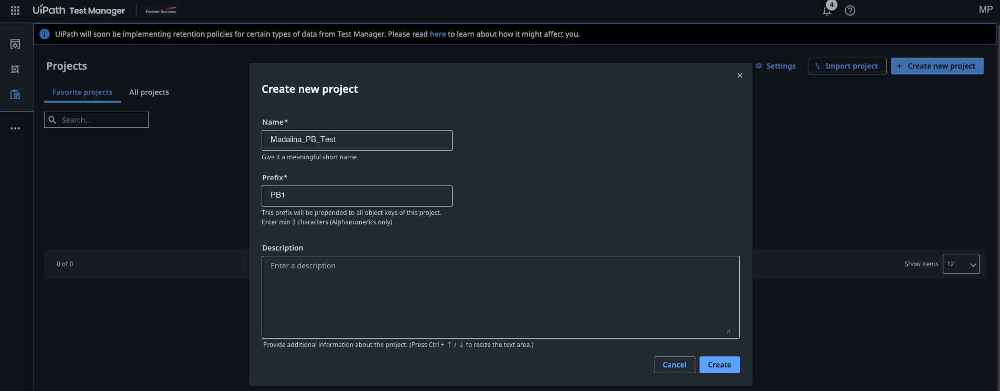
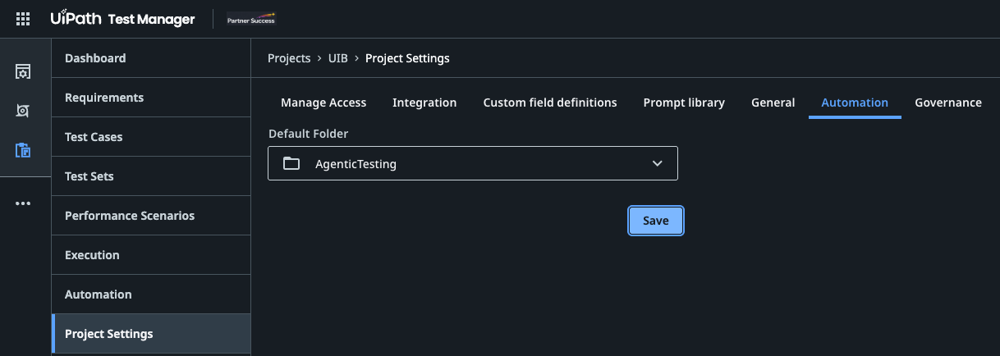
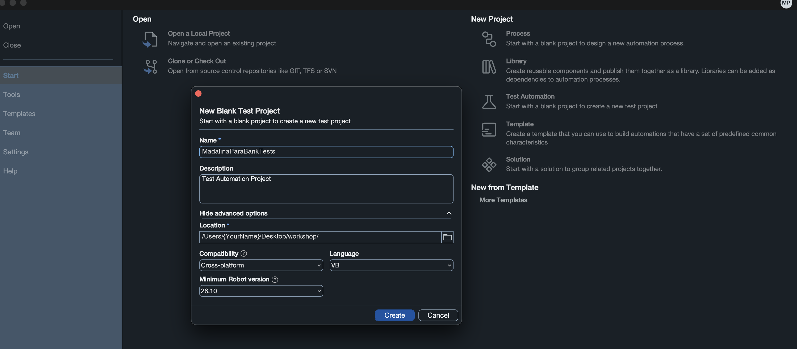

Hands-on · Testing Setup
{: .eyebrow }

# 🧭 Agentic Testing: Hands-On Session

**Take the ParaBank design document to requirements, test cases, automations, test sets, and executions in UiPath Test Cloud, with Autopilot for Testers, Autopilot for Developers, and a coding agent.**

## 👋 Overview

A QA team at a bank gets a new application description every sprint. Someone turns it into requirements. Someone types the test cases into **Test Manager** by hand. Someone else rebuilds each one in **Studio**, capturing every field and button. A fourth person groups them into test sets, runs them, and copies the results into a status email. That's four handoffs and hours of clicking, and the document, the requirements, the test cases, and the automations drift apart within a month.

In this session you'll do each of those jobs with AI agents, and see where a human still makes the call. **Autopilot** works inside the product: in **Studio** it creates requirements, test cases, test sets, and expressions, and in **Test Manager** it evaluates requirements, generates test cases, and runs a test case autonomously. A **coding agent** such as **Codex** or **Claude Code** works from your terminal and does the same automation work through the **`uip` CLI** and the **UiPath skills**. You'll build one test case by hand first, so you can judge what the agents build for you.

!!! tip "Training Environment"
    Log in at **[{{ training_url }}]({{ training_url }})** using tenant **{{ training_tenant }}**. The Autopilot features in this session are on **{{ env_label }}**, so make sure Studio, the `uip` CLI, and your browser all point there.

## 🗺️ What You'll Do

The hands-on part follows the [Agenda](agenda.md):

<div class="feature-grid" markdown>

<div class="feature" markdown>
<span class="f-icon">⚙️</span>
<span class="f-title" markdown="span">**[Setup](#setup)**</span>

Create a new project in Test Manager, a new test automation project in Studio, and connect them

👤 You

</div>

<div class="feature" markdown>
<span class="f-icon">📋</span>
<span class="f-title" markdown="span">**[Requirements](requirements.md)**</span>

Turn the ParaBank design document into requirements, discuss them, evaluate their quality, improve them, and evaluate again

👤 **Autopilot in Studio Desktop**, **Autopilot in Test Manager**, you

</div>

<div class="feature" markdown>
<span class="f-icon">🧪</span>
<span class="f-title" markdown="span">**[Test Cases](test-cases.md)**</span>

Generate test cases from a requirement, automate the Login test case by hand, generate the next one, see a test case run autonomously, add a few more, and find the obsolete ones

👤 **Autopilot in Test Manager**, you, **Autopilot in Studio Desktop** or a **coding agent**

</div>

<div class="feature" markdown>
<span class="f-icon">▶️</span>
<span class="f-title" markdown="span">**[Executions](executions.md)**</span>

Read what every run left behind

👤 You

</div>

<div class="feature" markdown>
<span class="f-icon">📦</span>
<span class="f-title" markdown="span">**[Test Sets](test-sets.md)**</span>

Create test sets from your test cases, run them, and look into their executions

👤 **Autopilot in Studio Desktop**, you

</div>

<div class="feature" markdown>
<span class="f-icon">🚀</span>
<span class="f-title" markdown="span">**[Next Steps](#next-steps)**</span>

Take it back to your own application

👤 You

</div>

</div>

## 🏦 The scenario

<div style="font-family: inherit; margin: 1.5rem 0 2rem;">

  <div style="background: #16213e; border-left: 10px solid #FA4616; padding: 26px 32px; margin-bottom: 22px;">
    <div style="font-size: 20px; font-weight: 700; color: #ffffff; line-height: 1.35;">A bank's QA team is moving its regression suite to agentic testing.</div>
    <div style="font-size: 15px; font-style: italic; color: #f6c3ab; margin-top: 10px; line-height: 1.45;">One design document. Requirements, test cases, test sets, and executions, built with Autopilot and a coding agent, with a tester deciding what counts as a pass.</div>
  </div>

  <div style="display: flex; flex-wrap: wrap; gap: 18px; align-items: stretch;">
  <div style="flex: 1 1 200px; background: #ffffff; border: 1px solid #e8e8e8; border-top: 5px solid #FA4616; padding: 20px 22px 22px; box-sizing: border-box;">
    <div style="display: flex; justify-content: space-between; align-items: flex-start; margin-bottom: 18px;">
      <span style="font-size: 40px; line-height: 46px;">📋</span>
      <span style="font-size: 34px; font-weight: 700; color: #f6c3ab; line-height: 1;">01</span>
    </div>
    <div style="font-size: 17px; font-weight: 700; color: #16213e; margin-bottom: 12px;">Requirements</div>
    <div style="font-size: 13.5px; color: #4a4a4a; line-height: 1.55; margin-bottom: 18px;">Autopilot in Studio Desktop writes them from the document. Autopilot in Test Manager grades them.</div>
    <div style="font-family: ui-monospace, SFMono-Regular, Menlo, monospace; font-size: 12.5px; color: #FA4616; font-weight: 600;">&rarr; 9 evaluated requirements</div>
  </div>
  <div style="flex: 1 1 200px; background: #ffffff; border: 1px solid #e8e8e8; border-top: 5px solid #FA4616; padding: 20px 22px 22px; box-sizing: border-box;">
    <div style="display: flex; justify-content: space-between; align-items: flex-start; margin-bottom: 18px;">
      <span style="font-size: 40px; line-height: 46px;">🧪</span>
      <span style="font-size: 34px; font-weight: 700; color: #f6c3ab; line-height: 1;">02</span>
    </div>
    <div style="font-size: 17px; font-weight: 700; color: #16213e; margin-bottom: 12px;">Test Cases</div>
    <div style="font-size: 13.5px; color: #4a4a4a; line-height: 1.55; margin-bottom: 18px;">Generated in Test Manager, automated by you, by Autopilot, or by a coding agent.</div>
    <div style="font-family: ui-monospace, SFMono-Regular, Menlo, monospace; font-size: 12.5px; color: #FA4616; font-weight: 600;">&rarr; Automated test cases</div>
  </div>
  <div style="flex: 1 1 200px; background: #ffffff; border: 1px solid #e8e8e8; border-top: 5px solid #FA4616; padding: 20px 22px 22px; box-sizing: border-box;">
    <div style="display: flex; justify-content: space-between; align-items: flex-start; margin-bottom: 18px;">
      <span style="font-size: 40px; line-height: 46px;">🔎</span>
      <span style="font-size: 34px; font-weight: 700; color: #f6c3ab; line-height: 1;">03</span>
    </div>
    <div style="font-size: 17px; font-weight: 700; color: #16213e; margin-bottom: 12px;">Executions</div>
    <div style="font-size: 13.5px; color: #4a4a4a; line-height: 1.55; margin-bottom: 18px;">Every run, manual, automated, or autonomous, with its results and evidence.</div>
    <div style="font-family: ui-monospace, SFMono-Regular, Menlo, monospace; font-size: 12.5px; color: #FA4616; font-weight: 600;">&rarr; Results you can read</div>
  </div>
  <div style="flex: 1 1 200px; background: #ffffff; border: 1px solid #e8e8e8; border-top: 5px solid #FA4616; padding: 20px 22px 22px; box-sizing: border-box;">
    <div style="display: flex; justify-content: space-between; align-items: flex-start; margin-bottom: 18px;">
      <span style="font-size: 40px; line-height: 46px;">📦</span>
      <span style="font-size: 34px; font-weight: 700; color: #f6c3ab; line-height: 1;">04</span>
    </div>
    <div style="font-size: 17px; font-weight: 700; color: #16213e; margin-bottom: 12px;">Test Sets</div>
    <div style="font-size: 13.5px; color: #4a4a4a; line-height: 1.55; margin-bottom: 18px;">Autopilot groups your test cases. You run them and read the results.</div>
    <div style="font-family: ui-monospace, SFMono-Regular, Menlo, monospace; font-size: 12.5px; color: #FA4616; font-weight: 600;">&rarr; An executed test set</div>
  </div>
  </div>

</div>

How the work moves through the session:

```text
ParaBank design document (.docx)
   │
   ▼
Setup          New {YourName}_PB_Test project in Test Manager ──▶ new test automation project in Studio ──▶ connected
   │
   ▼
Requirements   Autopilot in Studio Desktop ──▶ Requirements ──▶ Autopilot in Test Manager evaluates ──▶ you improve ──▶ re-evaluate
   │
   ▼
Test Cases     Autopilot in Test Manager ──▶ Test cases (manual steps)
                 ├─ Login: you automate it by hand in Studio
                 ├─ Next one: Autopilot in Studio Desktop, or your coding agent, automates it
                 ├─ Run Autonomously: Autopilot runs a manual test case itself
                 ├─ A few more
                 └─ Find obsolete tests: Autopilot flags regression test cases that no longer fit
   │
   ▼
Executions     Executions tab ──▶ every run so far
   │
   ▼
Test Sets      Autopilot in Studio Desktop ──▶ Test sets ──▶ publish ──▶ run ──▶ executions
```

## 📄 The design document

Everything in this session comes from one design document for the ParaBank web application: **E2E ParaBank Online Banking**. Download `E2E ParaBank Online Banking.docx` and save it in your workshop folder.

[Download the design document (.docx)](resources.assets/E2E%20ParaBank%20Online%20Banking.docx){ .md-button .md-button--primary }

<div class="feature-grid" markdown>

<div class="feature" markdown>
<span class="f-icon">🏦</span>
<span class="f-title" markdown="span">Application</span>

ParaBank, the Parasoft demo bank (Open New Account / Accounts Overview / Transfer Funds / Bill Pay / Find Transactions / Update Contact Info / Request Loan)

</div>

<div class="feature" markdown>
<span class="f-icon">🌐</span>
<span class="f-title" markdown="span">Environment</span>

`https://parabank.parasoft.com/parabank/index.htm` in Google Chrome

</div>

<div class="feature" markdown>
<span class="f-icon">📝</span>
<span class="f-title" markdown="span">What it describes</span>

Log in, open a Checking and a Savings account, transfer funds between them, pay a bill, find the transactions, request a loan, update the contact info, and log out

</div>

</div>

The document describes the customer journey in nine steps. You won't test it as one long end-to-end run. Each step becomes **a requirement** and **its own test cases**, so a failure points straight at the feature that broke, and one broken screen doesn't hide the results of the others.

<div class="circles" markdown>

<div class="circle-item" markdown>
<span class="num">0</span>
<div class="ci-body" markdown>

**Login & Initial State Check**

`/index.htm`, `/overview.htm`

✅ Login succeeds; initial account state captured

</div>
</div>

<div class="circle-item" markdown>
<span class="num">1</span>
<div class="ci-body" markdown>

**Open a Checking Account**

`/openaccount.htm`

✅ CHECKING account opened and listed in Accounts Overview

</div>
</div>

<div class="circle-item" markdown>
<span class="num">2</span>
<div class="ci-body" markdown>

**Open a Savings Account**

`/openaccount.htm`

✅ SAVINGS account opened; funding account reduced by the opening deposits

</div>
</div>

<div class="circle-item" markdown>
<span class="num">3</span>
<div class="ci-body" markdown>

**Transfer Funds Between Accounts**

`/transfer.htm`

✅ Transfer Complete; both balances change by exactly the transferred amount

</div>
</div>

<div class="circle-item" markdown>
<span class="num">4</span>
<div class="ci-body" markdown>

**Pay a Bill**

`/billpay.htm`

✅ Bill Payment Complete; payment debited from the Savings account

</div>
</div>

<div class="circle-item" markdown>
<span class="num">5</span>
<div class="ci-body" markdown>

**Find Transactions & Account Activity**

`/findtrans.htm`, `/activity.htm`

✅ Bill payment and transfer found with the right amounts

</div>
</div>

<div class="circle-item" markdown>
<span class="num">6</span>
<div class="ci-body" markdown>

**Request a Loan**

`/requestloan.htm`

✅ Loan approved; new loan account with balance = the loan amount

</div>
</div>

<div class="circle-item" markdown>
<span class="num">7</span>
<div class="ci-body" markdown>

**Update Contact Info**

`/updateprofile.htm`

✅ Profile Updated; the new phone number is saved

</div>
</div>

<div class="circle-item" markdown>
<span class="num">8</span>
<div class="ci-body" markdown>

**Logout & Evidence Collection**

`/index.htm`

✅ Session closed; screenshots attached to the report

</div>
</div>

</div>

### 🔢 The test data

These are the variables the design document defines. Use them in your prompts and your automations, so the requirements, the test cases, and the results all describe the same thing.

| Variable | What it holds | Value / rule |
| :--- | :--- | :--- |
| `var_Username`, `var_Password` | ParaBank login | From the Orchestrator credential asset `{YourName}_ParaBankCredential`. Never hard-coded. |
| `var_FundingAccountId` | Existing account that funds the new accounts | Extracted in Step 0: the first account in **Accounts Overview** |
| `var_CheckingAccountId` | New CHECKING account | Extracted in Step 1 |
| `var_SavingsAccountId` | New SAVINGS account | Extracted in Step 2 |
| `var_TransferAmount` | Amount to transfer | `10`, never more than the source account's available amount |
| `var_PayeeName` | Bill Pay payee | `AutoPayee_<yyyyMMddHHmm>`, unique per run |
| `var_PayeeAddress` / `City` / `State` / `Zip` / `Phone` | Payee contact details | `1 Main St` / `Bucharest` / `RO` / `010101` / `0700000000` |
| `var_PayeeAccount` | Payee account number, in **Account #** and **Verify Account #** | `12345` |
| `var_BillAmount` | Bill payment amount | `25` |
| `var_LoanAmount` | Loan amount | `1000` |
| `var_DownPayment` | Down payment for the loan | `100`, never more than the source account's available amount |
| `var_LoanAccountId` | Account created for the approved loan | Extracted in Step 6 |
| `var_NewPhone` | New phone number in **Update Contact Info** | `07<MMddHHmm>`, unique per run |

!!! warning "Three things every test case must handle"

    - **It runs on its own.** Test cases run in any order, on any robot. In the document, the transfer uses the accounts from Steps 1 and 2, and the bill payment and the search reuse them. As test cases, each one opens the accounts it needs, and makes the payment or transfer it searches for, at the start.
    - **A shared demo database.** ParaBank is a public demo used by many people, and its database is reset from time to time. If login fails with *"The username and password could not be verified."*, register your user again. Account numbers are generated by ParaBank: always read them at run time, never hard-code them.
    - **Unknown loan rules.** The loan decision depends on how the demo is configured and on the funds available. Keep the loan amount and the down payment small, and read the **Status** on screen rather than assuming approval.

### 🗂️ The regression test cases

Section 6 of the design document adds ten regression test cases, **TC-PB-002** to **TC-PB-011**, kept in the same test set as the end-to-end scenario. Each one runs on its own after the login in Step 0.

| ID | Test case | Expected result | Requirement |
| :--- | :--- | :--- | :--- |
| TC-PB-002 | Customer Registration | New customer registered and logged in | Login & Initial State Check |
| TC-PB-003 | Login with Invalid Credentials | Login rejected with an error message | Login & Initial State Check |
| TC-PB-004 | Forgot Login Info | Username and password recovered from customer data | Login & Initial State Check |
| TC-PB-005 | Rename Account Nickname | Account shown with the new nickname | Open a Checking Account |
| TC-PB-006 | Bill Pay - Account Number Mismatch | Payment blocked by field validation | Pay a Bill |
| TC-PB-007 | Loan Status Lookup by Loan ID | Loan details retrieved by Loan ID | Request a Loan |
| TC-PB-008 | Transfer Funds - Review & Confirm | Transfer runs only after confirmation | Transfer Funds Between Accounts |
| TC-PB-009 | Loan Request - Insufficient Down Payment | Loan denied with an explanation | Request a Loan |
| TC-PB-010 | Login with SMS One-Time Password | Second authentication factor required | Login & Initial State Check |
| TC-PB-011 | Download Account Statement (PDF) | Monthly statement downloaded as PDF | Find Transactions & Account Activity |

!!! warning "Not all of them still fit ParaBank"
    Like most real test suites, this list has aged. Some of these test cases describe screens or features ParaBank doesn't have. Don't fix them yet: in [Test Cases](test-cases.md#find-obsolete-test-cases), you'll ask Autopilot to find them, then check its answer yourself.

### 📋 What's Test Manager?

<div style="background: #16213e; border-left: 10px solid #FA4616; padding: 22px 28px; margin: 1.2rem 0 1.4rem;">
  <div style="font-size: 19px; font-weight: 700; color: #ffffff; line-height: 1.35;">The planning and reporting hub of UiPath Test Cloud.</div>
  <div style="font-size: 15px; font-style: italic; color: #f6c3ab; margin-top: 9px;">Requirements say what must work. Test cases say how you'll prove it. Test sets and executions say whether it did.</div>
</div>

<div style="display: flex; flex-wrap: wrap; gap: 14px; align-items: stretch; margin-bottom: 1.5rem;">
  <div style="flex: 1 1 220px; background: #ffffff; border: 1px solid #e8e8e8; border-top: 4px solid #FA4616; padding: 18px 20px; box-sizing: border-box;">
    <div style="font-size: 17px; font-weight: 700; color: #16213e; margin-bottom: 9px;">Requirement</div>
    <div style="font-size: 14.5px; color: #4a4a4a; line-height: 1.55;">What the application must do, and the acceptance criteria</div>
  </div>
  <div style="flex: 1 1 220px; background: #ffffff; border: 1px solid #e8e8e8; border-top: 4px solid #FA4616; padding: 18px 20px; box-sizing: border-box;">
    <div style="font-size: 17px; font-weight: 700; color: #16213e; margin-bottom: 9px;">Test case</div>
    <div style="font-size: 14.5px; color: #4a4a4a; line-height: 1.55;">A scenario with manual steps, linked to the requirement it covers, and optionally to an automation</div>
  </div>
  <div style="flex: 1 1 220px; background: #ffffff; border: 1px solid #e8e8e8; border-top: 4px solid #FA4616; padding: 18px 20px; box-sizing: border-box;">
    <div style="font-size: 17px; font-weight: 700; color: #16213e; margin-bottom: 9px;">Test set</div>
    <div style="font-size: 14.5px; color: #4a4a4a; line-height: 1.55;">The group of test cases you execute together</div>
  </div>
  <div style="flex: 1 1 220px; background: #ffffff; border: 1px solid #e8e8e8; border-top: 4px solid #FA4616; padding: 18px 20px; box-sizing: border-box;">
    <div style="font-size: 17px; font-weight: 700; color: #16213e; margin-bottom: 9px;">Execution</div>
    <div style="font-size: 14.5px; color: #4a4a4a; line-height: 1.55;">One run, with a log, result, and evidence per test case</div>
  </div>
</div>

## ⚙️ Setup

<div style="font-size: 15px; font-style: italic; color: #d1603a; margin: -0.6rem 0 1rem;">A Test Manager project, and a test automation project connected to it</div>

<div style="background: #faf8f6; border: 1px solid #eee3dc; border-left: 4px solid #FA4616; padding: 18px 22px; margin: 1.4rem 0;">
  <div style="font-size: 14px; font-weight: 700; letter-spacing: 0.09em; color: #FA4616; margin-bottom: 9px;">WHAT YOU NEED</div>
  <ul style="margin: 0; padding-left: 18px; font-size: 15px; color: #4a4a4a; line-height: 1.55;"><li style="margin-bottom: 5px;"><strong>Test Manager</strong> open in your browser on the <strong>{{ training_tenant }}</strong> tenant.</li></ul>
</div>

### 🆕 Create a new project in Test Manager

Requirements, test cases, test sets, and executions all live in a Test Manager project. Create yours first: everything Autopilot generates in the next parts goes into it.

1. Go to **[{{ training_url }}]({{ training_url }})**, select the **{{ training_tenant }}** tenant, and open **Test Manager**.
2. On the **Projects** page, select **Create new project**.
3. In the **Create new project** dialog, fill in:
    - **Name:** `{YourName}_PB_Test`
    - **Prefix:** `{YourPrefix}`, a unique code of 3 to 5 letters and numbers: your initials plus a digit, for example `VC1`. Everyone works in the same tenant, and each prefix can be used only once in it. You can't change it later.
    - **Description:** optional, for example *ParaBank online banking tests*.

    { .screenshot width="900" }
    *The Create new project dialog. The screenshot uses the prefix PB1: use your own.*

    !!! info "What the prefix is for"
        Every object in the project gets a key that starts with the prefix: with the prefix `VC1`, the first requirement becomes `VC1:1`, the next `VC1:2`, and so on, across requirements, test cases, and test sets. Short and recognizable beats descriptive.

4. Select **Create**, then open the project. It's empty for now.
5. Set the project's default Orchestrator folder. Test sets need it to run automated test cases later.
    1. In the project's left menu, select **Project Settings**, then the **Automation** tab.
    2. In **Default Folder**, select `{{ training_folder }}`.
    3. Select **Save**.

    { .screenshot width="800" }
    *Project Settings > Automation, with `{{ training_folder }}` as the default folder.*

!!! tip "Why your name in the project name"
    Everyone in the session works in the same tenant. Your name keeps your project easy to find in the **Projects** list, and keeps your requirements, test cases, and results apart from everyone else's.

### 🛠️ Create a new test automation project in UiPath Studio Desktop

1. Open **Studio**. On the **Start** screen, under **New Project**, select **Test Automation**.
2. In the **New Blank Test Project** dialog, fill in:
    - **Name:** `{YourName}ParaBankTests`
    - **Description:** optional, for example *Test Automation Project*

    { .screenshot width="900" }

3. Select **Create**.
4. Studio opens the new project. In the **Project** panel, expand **Dependencies** and check that the testing packages are there, such as `UiPath.Testing.Activities` and `UiPath.UIAutomation.Activities`.

!!! tip "Why a test automation project"
    A test automation project is built for test cases: it has the testing activities, the Given / When / Then template, and the **Test Explorer** panel. Each test case in it can be linked to a test case in Test Manager, and its results go back to Test Manager when it runs there.

### 🔗 Connect it to Test Manager

The project needs to know which Test Manager project its requirements, test cases, and results belong to. Pick one way:

=== "In Studio"

    1. In the **Explorer** panel, right-click your project name and select **Project Settings**.
    2. Select **Test Manager Configuration**.
    3. Under **Test Manager Settings**, enter the Test Manager URL `{{ training_url }}/{{ training_tenant }}/testmanager_`, then select **Connect**. The status changes to **Connected**.
    4. In **Default Project**, type your prefix and select **{YourName}_PB_Test ({YourPrefix})**.
    5. Select **OK**.

    <video src="../agentic-testing-hands-on.images/studio-connect-test-manager.mp4" autoplay loop muted playsinline controls aria-label="Connecting the Studio project to Test Manager: Project Settings, Test Manager Configuration, entering the Test Manager URL, Connect, selecting the default project, and OK" style="display: block; width: 100%; margin: 1.5rem auto; border: 1px solid var(--md-default-fg-color--lightest); border-radius: 4px; box-shadow: 0 2px 8px rgba(0, 0, 0, 0.12);"></video>

=== "With your coding agent"

    Close the project in Studio, start your coding agent in your workshop folder, and give it this prompt:

    ```text
    Connect the Studio project in ./{YourName}ParaBankTests to Test Manager at
    {{ training_url }}/{{ training_tenant }}/testmanager_ with my {YourName}_PB_Test project
    (prefix {YourPrefix}) as the default project, and show me uip rpa tm status.
    ```

    Then reopen the project in Studio. The connection is stored in the project's `.tmh/config.json`, so Studio, Autopilot, and the CLI all use the same one.

### ✅ Check you're ready

- Studio shows **{YourName}_PB_Test** as the default Test Manager project.
- The **Autopilot** panel opens in Studio.
- **Test Manager** is open in your browser, on the **{YourName}_PB_Test** project.

Your workshop folder now looks like this:

```text
workshop/
├── {YourName}ParaBankTests/           ← Studio test automation project, connected to Test Manager
└── E2E ParaBank Online Banking.docx   ← the design document
```

!!! success "Setup done"
    A new **{YourName}_PB_Test** project in Test Manager, and a new test automation project in Studio connected to it. Autopilot can now write requirements straight into it.

## 🚀 Next Steps

<div style="font-size: 15px; font-style: italic; color: #d1603a; margin: -0.6rem 0 1rem;">What you built, and what to take home</div>

<div class="feature-grid" markdown>

<div class="feature" markdown>
<span class="f-icon">📋</span>
<span class="f-title" markdown="span">Requirements</span>

Nine requirements generated by Autopilot in Studio Desktop from one design document, evaluated and improved with Autopilot in Test Manager

</div>

<div class="feature" markdown>
<span class="f-icon">🧪</span>
<span class="f-title" markdown="span">Test Cases</span>

Test cases generated by Autopilot in Test Manager; Login automated by hand; more automated by Autopilot in Studio Desktop or a coding agent; one autonomous run; obsolete regression test cases found and un-assigned

</div>

<div class="feature" markdown>
<span class="f-icon">🔎</span>
<span class="f-title" markdown="span">Executions</span>

Every run recorded with results and evidence, traceable to its requirement

</div>

<div class="feature" markdown>
<span class="f-icon">📦</span>
<span class="f-title" markdown="span">Test Sets</span>

A smoke set and a regression set created by Autopilot and executed on a robot

</div>

</div>

**Ongoing**

- Bring your questions. No question is too basic, especially this early.
- Tell us when something doesn't work. Run `uip feedback send` the moment a skill guesses wrong, a command fails, or a step takes three tries.

## ⚠️ Gotchas you'll hit

Things every QA team learns in the first month.

<div class="feature-grid" markdown>

<div class="feature" markdown>
<span class="f-icon">🔍</span>
<span class="f-title" markdown="span">Trust but verify</span>

Autopilot and coding agents are fast and confident. Read the generated requirements, test cases, and assertions: a test that checks nothing passes every time.

</div>

<div class="feature" markdown>
<span class="f-icon">🎯</span>
<span class="f-title" markdown="span">Pick the right agent</span>

Autopilot for what's in front of you in the product. A coding agent for work that spans files, projects, and products.

</div>

<div class="feature" markdown>
<span class="f-icon">🧩</span>
<span class="f-title" markdown="span">Independent test cases</span>

Every test sets up its own data in **Given**. Run them in a different order once to prove it.

</div>

<div class="feature" markdown>
<span class="f-icon">✍️</span>
<span class="f-title" markdown="span">Good manual steps pay twice</span>

One action and one expected result per step helps Autopilot generate the automation, and run the test case autonomously.

</div>

<div class="feature" markdown>
<span class="f-icon">🎯</span>
<span class="f-title" markdown="span">Never hand-write selectors</span>

Capture targets from the live app into the Object Repository. A plausible-looking selector that matches nothing costs more than the capture.

</div>

<div class="feature" markdown>
<span class="f-icon">🌐</span>
<span class="f-title" markdown="span">One environment</span>

Studio, the CLI, and the browser on the same tenant. Most "Autopilot can't find my project" problems are a Studio signed in somewhere else.

</div>

</div>
