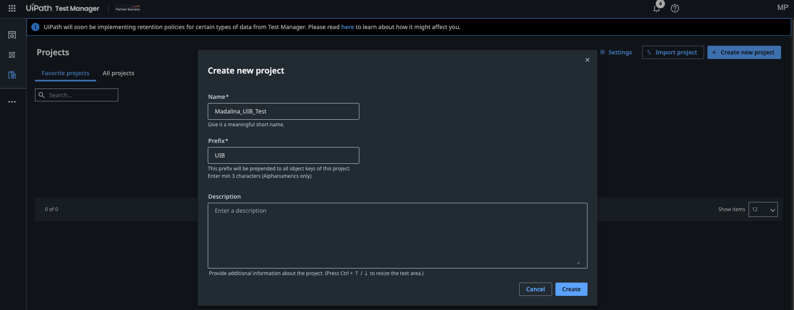
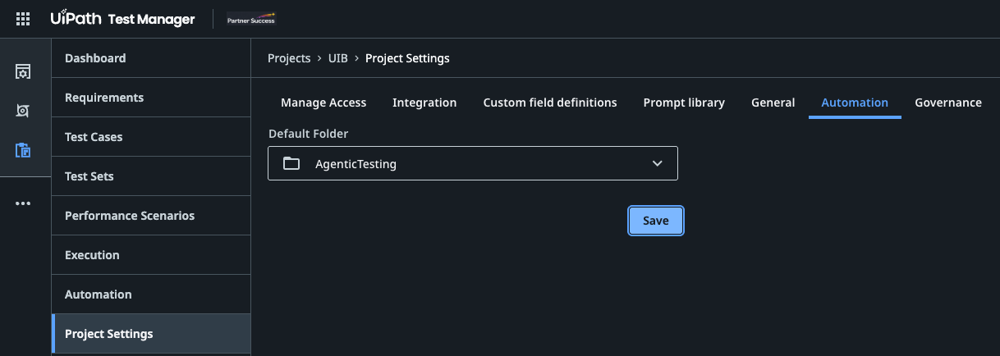
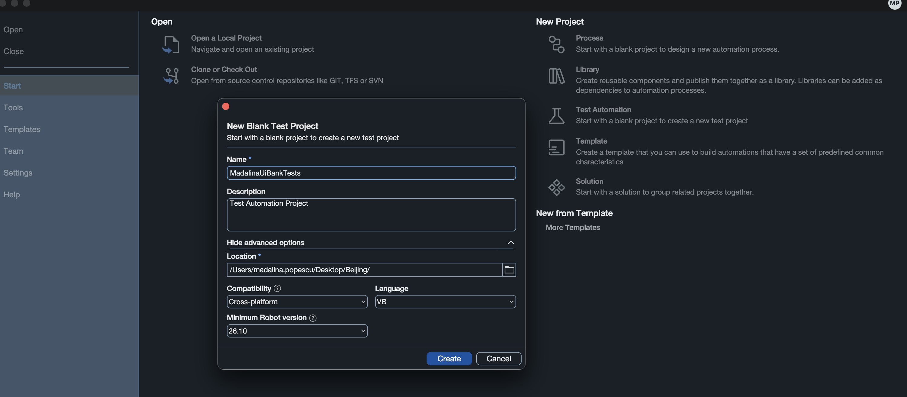

动手实践 · 测试环境准备
{: .eyebrow }

# 🧭 智能体测试：动手实践课 { #agentic-testing-hands-on-session }

**借助 Autopilot for Testers、Autopilot for Developers 和编码智能体，在 UiPath Test Cloud 中把 UiBank 设计文档一路变成需求、测试用例、自动化、测试集和执行。**

## 👋 概述 { #overview }

一家银行的 QA 团队每个迭代都会拿到一份新的应用说明。有人把它整理成需求。有人在 **Test Manager** 里手动录入测试用例。另一个人在 **Studio** 中逐个重建，捕获每个字段和按钮。第四个人把它们分组成测试集、运行，再把结果复制到状态邮件里。这就是四次交接和数小时的点击操作，而且不到一个月，文档、需求、测试用例和自动化之间就会彼此脱节。

在本课中，你会借助 AI 智能体完成上述每一项工作，并看到哪些地方仍然需要人来做决定。**Autopilot** 在产品内部工作：在 **Studio** 中，它创建需求、测试用例、测试集和表达式；在 **Test Manager** 中，它评估需求、生成测试用例，并自主运行测试用例。**编码智能体**（例如 **Codex** 或 **Claude Code**）在你的终端中工作，通过 **`uip` CLI** 和 **UiPath skills** 完成同样的自动化工作。你会先手动构建一个测试用例，这样才能判断智能体为你构建的内容。

!!! tip "培训环境"
    使用租户 **{{ training_tenant }}** 登录 **[{{ training_url }}]({{ training_url }})**。本课中的 Autopilot 功能位于 **{{ env_label }}**，所以请确保 Studio、`uip` CLI 和浏览器都指向这里。

## 🗺️ 你将完成的内容 { #what-youll-do }

动手实践部分遵循[议程](agenda.md)：

<div class="feature-grid" markdown>

<div class="feature" markdown>
<span class="f-icon">⚙️</span>
<span class="f-title" markdown="span">**[环境准备](#setup)**</span>

在 Test Manager 中新建项目，在 Studio 中新建测试自动化项目，并将两者连接起来

👤 你

</div>

<div class="feature" markdown>
<span class="f-icon">📋</span>
<span class="f-title" markdown="span">**[需求](requirements.md)**</span>

把 UiBank 设计文档变成需求，讨论这些需求，评估其质量，改进后再次评估

👤 **Autopilot in Studio Desktop**、**Autopilot in Test Manager**、你

</div>

<div class="feature" markdown>
<span class="f-icon">🧪</span>
<span class="f-title" markdown="span">**[测试用例](test-cases.md)**</span>

根据需求生成测试用例，手动自动化 Login 测试用例，生成下一个测试用例，观看测试用例自主运行，再添加几个

👤 **Autopilot in Test Manager**、你、**Autopilot in Studio Desktop** 或**编码智能体**

</div>

<div class="feature" markdown>
<span class="f-icon">▶️</span>
<span class="f-title" markdown="span">**[执行](executions.md)**</span>

查看每次运行留下的结果

👤 你

</div>

<div class="feature" markdown>
<span class="f-icon">📦</span>
<span class="f-title" markdown="span">**[测试集](test-sets.md)**</span>

用你的测试用例创建测试集，运行它们，并查看其执行

👤 **Autopilot in Studio Desktop**、你

</div>

<div class="feature" markdown>
<span class="f-icon">🚀</span>
<span class="f-title" markdown="span">**[后续步骤](#next-steps)**</span>

把所学带回你自己的应用

👤 你

</div>

</div>

## 🏦 场景 { #the-scenario }

<div style="font-family: inherit; margin: 1.5rem 0 2rem;">

  <div style="background: #16213e; border-left: 10px solid #FA4616; padding: 26px 32px; margin-bottom: 22px;">
    <div style="font-size: 20px; font-weight: 700; color: #ffffff; line-height: 1.35;">一家银行的 QA 团队正在把回归测试套件迁移到智能体测试。</div>
    <div style="font-size: 15px; font-style: italic; color: #f6c3ab; margin-top: 10px; line-height: 1.45;">一份设计文档。借助 Autopilot 和编码智能体构建需求、测试用例、测试集和执行，由测试人员决定什么算通过。</div>
  </div>

  <div style="display: flex; flex-wrap: wrap; gap: 18px; align-items: stretch;">
  <div style="flex: 1 1 200px; background: #ffffff; border: 1px solid #e8e8e8; border-top: 5px solid #FA4616; padding: 20px 22px 22px; box-sizing: border-box;">
    <div style="display: flex; justify-content: space-between; align-items: flex-start; margin-bottom: 18px;">
      <span style="font-size: 40px; line-height: 46px;">📋</span>
      <span style="font-size: 34px; font-weight: 700; color: #f6c3ab; line-height: 1;">01</span>
    </div>
    <div style="font-size: 17px; font-weight: 700; color: #16213e; margin-bottom: 12px;">需求</div>
    <div style="font-size: 13.5px; color: #4a4a4a; line-height: 1.55; margin-bottom: 18px;">Autopilot in Studio Desktop 根据文档编写需求，Autopilot in Test Manager 为其评分。</div>
    <div style="font-family: ui-monospace, SFMono-Regular, Menlo, monospace; font-size: 12.5px; color: #FA4616; font-weight: 600;">&rarr; 8 个已评估的需求</div>
  </div>
  <div style="flex: 1 1 200px; background: #ffffff; border: 1px solid #e8e8e8; border-top: 5px solid #FA4616; padding: 20px 22px 22px; box-sizing: border-box;">
    <div style="display: flex; justify-content: space-between; align-items: flex-start; margin-bottom: 18px;">
      <span style="font-size: 40px; line-height: 46px;">🧪</span>
      <span style="font-size: 34px; font-weight: 700; color: #f6c3ab; line-height: 1;">02</span>
    </div>
    <div style="font-size: 17px; font-weight: 700; color: #16213e; margin-bottom: 12px;">测试用例</div>
    <div style="font-size: 13.5px; color: #4a4a4a; line-height: 1.55; margin-bottom: 18px;">在 Test Manager 中生成，由你、Autopilot 或编码智能体实现自动化。</div>
    <div style="font-family: ui-monospace, SFMono-Regular, Menlo, monospace; font-size: 12.5px; color: #FA4616; font-weight: 600;">&rarr; 已自动化的测试用例</div>
  </div>
  <div style="flex: 1 1 200px; background: #ffffff; border: 1px solid #e8e8e8; border-top: 5px solid #FA4616; padding: 20px 22px 22px; box-sizing: border-box;">
    <div style="display: flex; justify-content: space-between; align-items: flex-start; margin-bottom: 18px;">
      <span style="font-size: 40px; line-height: 46px;">🔎</span>
      <span style="font-size: 34px; font-weight: 700; color: #f6c3ab; line-height: 1;">03</span>
    </div>
    <div style="font-size: 17px; font-weight: 700; color: #16213e; margin-bottom: 12px;">执行</div>
    <div style="font-size: 13.5px; color: #4a4a4a; line-height: 1.55; margin-bottom: 18px;">每一次运行（手动、自动或自主），连同其结果和证据。</div>
    <div style="font-family: ui-monospace, SFMono-Regular, Menlo, monospace; font-size: 12.5px; color: #FA4616; font-weight: 600;">&rarr; 一目了然的结果</div>
  </div>
  <div style="flex: 1 1 200px; background: #ffffff; border: 1px solid #e8e8e8; border-top: 5px solid #FA4616; padding: 20px 22px 22px; box-sizing: border-box;">
    <div style="display: flex; justify-content: space-between; align-items: flex-start; margin-bottom: 18px;">
      <span style="font-size: 40px; line-height: 46px;">📦</span>
      <span style="font-size: 34px; font-weight: 700; color: #f6c3ab; line-height: 1;">04</span>
    </div>
    <div style="font-size: 17px; font-weight: 700; color: #16213e; margin-bottom: 12px;">测试集</div>
    <div style="font-size: 13.5px; color: #4a4a4a; line-height: 1.55; margin-bottom: 18px;">Autopilot 为你的测试用例分组。你来运行并查看结果。</div>
    <div style="font-family: ui-monospace, SFMono-Regular, Menlo, monospace; font-size: 12.5px; color: #FA4616; font-weight: 600;">&rarr; 一个已执行的测试集</div>
  </div>
  </div>

</div>

工作在本课中的流转方式：

```text
UiBank design document (.docx)
   │
   ▼
Setup          New {YourName}_UIB_Test project in Test Manager ──▶ new test automation project in Studio ──▶ connected
   │
   ▼
Requirements   Autopilot in Studio Desktop ──▶ Requirements ──▶ Autopilot in Test Manager evaluates ──▶ you improve ──▶ re-evaluate
   │
   ▼
Test Cases     Autopilot in Test Manager ──▶ Test cases (manual steps)
                 ├─ Login: you automate it by hand in Studio
                 ├─ Next one: Autopilot in Studio Desktop, or your coding agent, automates it
                 ├─ Run Autonomously: Autopilot runs a manual test case itself
                 └─ A few more
   │
   ▼
Executions     Executions tab ──▶ every run so far
   │
   ▼
Test Sets      Autopilot in Studio Desktop ──▶ Test sets ──▶ publish ──▶ run ──▶ executions
```

## 📄 设计文档 { #the-design-document }

本课的一切都来自 UiBank Web 应用的一份设计文档：**E2E UiBank Online Banking**。下载 `E2E UiBank Online Banking.docx`，并保存到你的工作坊文件夹中。

[下载设计文档 (.docx)](resources.assets/E2E%20UiBank%20Online%20Banking.docx){ .md-button .md-button--primary }

<div class="feature-grid" markdown>

<div class="feature" markdown>
<span class="f-icon">🏦</span>
<span class="f-title" markdown="span">应用</span>

UiBank Web Application v2.0.0（Accounts / Transfers / Loans / Profile）

</div>

<div class="feature" markdown>
<span class="f-icon">🌐</span>
<span class="f-title" markdown="span">环境</span>

在 Google Chrome 中打开 `https://uibank.uipath.com`。备用地址：`https://purple-dune-0af054403.6.azurestaticapps.net`

</div>

<div class="feature" markdown>
<span class="f-icon">📝</span>
<span class="f-title" markdown="span">文档内容</span>

登录，开立一个 Checking 账户和一个 Savings 账户，在两者之间转账，申请贷款，通过 Loan ID 查询贷款，并验证用户资料

</div>

</div>

文档用八个步骤描述了客户旅程。你不会把它作为一次很长的端到端运行来测试。每个步骤都会成为**一个需求**以及**它自己的测试用例**，这样一旦失败，就能直接定位到出问题的功能，而且一个页面出错也不会掩盖其他步骤的结果。

<div class="circles" markdown>

<div class="circle-item" markdown>
<span class="num">0</span>
<div class="ci-body" markdown>

**Login and Initial Account State**

`/login`, `/accounts`

✅ 登录成功；已记录初始账户状态

</div>
</div>

<div class="circle-item" markdown>
<span class="num">1</span>
<div class="ci-body" markdown>

**Checking Account Creation**

`/accounts/account-apply`

✅ Checking 账户出现在账户汇总中

</div>
</div>

<div class="circle-item" markdown>
<span class="num">2</span>
<div class="ci-body" markdown>

**Savings Account Creation**

`/accounts/account-apply`

✅ Savings 账户出现在账户汇总中

</div>
</div>

<div class="circle-item" markdown>
<span class="num">3</span>
<div class="ci-body" markdown>

**Funds Transfer Between Accounts**

`/accounts/transfer-money`

✅ 两个账户的余额变动恰好等于转账金额

</div>
</div>

<div class="circle-item" markdown>
<span class="num">4</span>
<div class="ci-body" markdown>

**Loan Application Submission**

`/loans/apply`

✅ 已生成 Loan ID

</div>
</div>

<div class="circle-item" markdown>
<span class="num">5</span>
<div class="ci-body" markdown>

**Loan Status Lookup**

`/loans/lookup`

✅ 金额和期限与提交的内容一致

</div>
</div>

<div class="circle-item" markdown>
<span class="num">6</span>
<div class="ci-body" markdown>

**User Profile Identity Verification**

`/userprofile`

✅ 用户名和邮箱与当前登录用户一致

</div>
</div>

<div class="circle-item" markdown>
<span class="num">7</span>
<div class="ci-body" markdown>

**Logout and Evidence Collection**

`/`

✅ 会话已关闭；截图已附加到报告中

</div>
</div>

</div>

### 🔢 测试数据 { #the-test-data }

以下是设计文档定义的变量。在你的提示词和自动化中使用它们，让需求、测试用例和结果描述的都是同一件事。

| 变量 | 含义 | 值 / 规则 |
| :--- | :--- | :--- |
| `var_Username`, `var_Password` | UiBank 登录信息 | 来自 Orchestrator 凭据资产 `{YourName}_UiBankCredential`。绝不硬编码。 |
| `var_CheckingNickname` | 新的 Checking 账户 | `AutoChecking_<yyyyMMddHHmmss>`，每次运行唯一 |
| `var_SavingsNickname` | 新的 Savings 账户 | `AutoSavings_<yyyyMMddHHmmss>`，每次运行唯一 |
| `var_TransferAmount` | 转账金额 | `10`，绝不超过转出账户余额 |
| `var_LoanEmail` | 贷款申请人邮箱 | 你在 UiBank 上注册的邮箱 |
| `var_LoanAmount` | 贷款金额 | `5000` |
| `var_LoanTerm` | 贷款期限（年） | `3`（允许值：1、3、5、10） |
| `var_YearlyIncome` | 税前年收入 | `60000` |
| `var_Age` | 申请人年龄 | `35` |
| `var_LoanID` | UiBank 返回的 Loan ID | 提交贷款后提取 |

!!! warning "每个测试用例都必须处理的三件事"

    - **独立运行**。测试用例可能以任意顺序、在任意机器人上运行。在文档中，转账使用步骤 1 和步骤 2 创建的账户，查询使用步骤 4 生成的 Loan ID。作为测试用例，转账会在开始时自己开立两个账户，查询会在开始时自己提交一笔贷款。
    - **尚无账户**。新的 UiBank 用户看到的不是表格，而是 *"No accounts at this time, apply for a new account today!"*。这是有效的初始状态，不是失败。
    - **未知规则**。UiBank 是一个演示应用。余额和贷款审批规则没有文档说明，数据也可能被重置。请检查贷款结果，而不要假定一定会获批。

### 📋 什么是 Test Manager？ { #whats-test-manager }

<div style="background: #16213e; border-left: 10px solid #FA4616; padding: 22px 28px; margin: 1.2rem 0 1.4rem;">
  <div style="font-size: 19px; font-weight: 700; color: #ffffff; line-height: 1.35;">UiPath Test Cloud 的规划与报告中心。</div>
  <div style="font-size: 15px; font-style: italic; color: #f6c3ab; margin-top: 9px;">需求说明什么必须能正常工作。测试用例说明你将如何证明。测试集和执行说明它是否做到了。</div>
</div>

<div style="display: flex; flex-wrap: wrap; gap: 14px; align-items: stretch; margin-bottom: 1.5rem;">
  <div style="flex: 1 1 220px; background: #ffffff; border: 1px solid #e8e8e8; border-top: 4px solid #FA4616; padding: 18px 20px; box-sizing: border-box;">
    <div style="font-size: 17px; font-weight: 700; color: #16213e; margin-bottom: 9px;">需求</div>
    <div style="font-size: 14.5px; color: #4a4a4a; line-height: 1.55;">应用必须做到的事情，以及验收标准</div>
  </div>
  <div style="flex: 1 1 220px; background: #ffffff; border: 1px solid #e8e8e8; border-top: 4px solid #FA4616; padding: 18px 20px; box-sizing: border-box;">
    <div style="font-size: 17px; font-weight: 700; color: #16213e; margin-bottom: 9px;">测试用例</div>
    <div style="font-size: 14.5px; color: #4a4a4a; line-height: 1.55;">一个包含手动步骤的场景，关联到它所覆盖的需求，也可以关联到一个自动化</div>
  </div>
  <div style="flex: 1 1 220px; background: #ffffff; border: 1px solid #e8e8e8; border-top: 4px solid #FA4616; padding: 18px 20px; box-sizing: border-box;">
    <div style="font-size: 17px; font-weight: 700; color: #16213e; margin-bottom: 9px;">测试集</div>
    <div style="font-size: 14.5px; color: #4a4a4a; line-height: 1.55;">一起执行的一组测试用例</div>
  </div>
  <div style="flex: 1 1 220px; background: #ffffff; border: 1px solid #e8e8e8; border-top: 4px solid #FA4616; padding: 18px 20px; box-sizing: border-box;">
    <div style="font-size: 17px; font-weight: 700; color: #16213e; margin-bottom: 9px;">执行</div>
    <div style="font-size: 14.5px; color: #4a4a4a; line-height: 1.55;">一次运行，每个测试用例都有日志、结果和证据</div>
  </div>
</div>

## ⚙️ 环境准备 { #setup }

<div style="font-size: 15px; font-style: italic; color: #d1603a; margin: -0.6rem 0 1rem;">一个 Test Manager 项目，以及一个与之连接的测试自动化项目</div>

<div style="background: #faf8f6; border: 1px solid #eee3dc; border-left: 4px solid #FA4616; padding: 18px 22px; margin: 1.4rem 0;">
  <div style="font-size: 14px; font-weight: 700; letter-spacing: 0.09em; color: #FA4616; margin-bottom: 9px;">你需要准备</div>
  <ul style="margin: 0; padding-left: 18px; font-size: 15px; color: #4a4a4a; line-height: 1.55;"><li style="margin-bottom: 5px;">在浏览器中打开 <strong>{{ training_tenant }}</strong> 租户上的 <strong>Test Manager</strong>。</li></ul>
</div>

### 🆕 在 Test Manager 中新建项目 { #create-a-new-project-in-test-manager }

需求、测试用例、测试集和执行都存放在一个 Test Manager 项目中。先创建你的项目：后续各部分中 Autopilot 生成的所有内容都会放进去。

1. 打开 **[{{ training_url }}]({{ training_url }})**，选择 **{{ training_tenant }}** 租户，然后打开 **Test Manager**。
2. 在 **Projects** 页面上，选择 **Create new project**。
3. 在 **Create new project** 对话框中填写：
    - **Name：** `{YourName}_UIB_Test`
    - **Prefix：** `{YourPrefix}`，一个由 3 到 5 个字母和数字组成的唯一代码：你的姓名首字母加一个数字，例如 `VC1`。所有人都在同一个租户中工作，每个前缀在租户中只能使用一次。创建后无法更改。
    - **Description：** 可选，例如 *UiBank online banking tests*。

    { .screenshot width="900" }
    *Create new project 对话框。截图中使用的前缀是 UIB：请使用你自己的前缀。*

    !!! info "前缀的用途"
        项目中的每个对象都会获得一个以前缀开头的键：如果前缀是 `VC1`，第一个需求就是 `VC1:1`，下一个是 `VC1:2`，依此类推，需求、测试用例和测试集都是如此。简短易认比描述性更重要。

4. 选择 **Create**，然后打开项目。它目前是空的。
5. 设置项目的默认 Orchestrator 文件夹。测试集稍后运行已自动化的测试用例时需要用到它。
    1. 在项目左侧菜单中，选择 **Project Settings**，然后选择 **Automation** 选项卡。
    2. 在 **Default Folder** 中，选择 `{{ training_folder }}`。
    3. 选择 **Save**。

    { .screenshot width="800" }
    *Project Settings > Automation，默认文件夹为 `{{ training_folder }}`。*

!!! tip "为什么在项目名称中加入你的名字"
    本课所有人都在同一个租户中工作。加上你的名字，便于你在 **Projects** 列表中找到自己的项目，也能把你的需求、测试用例和结果与其他人的区分开。

### 🛠️ 在 UiPath Studio Desktop 中新建测试自动化项目 { #create-a-new-test-automation-project-in-uipath-studio-desktop }

1. 打开 **Studio**。在 **Start** 界面的 **New Project** 下，选择 **Test Automation**。
2. 在 **New Blank Test Project** 对话框中填写：
    - **Name：** `{YourName}UiBankTests`
    - **Description：** 可选，例如 *Test Automation Project*

    { .screenshot width="900" }

3. 选择 **Create**。
4. Studio 会打开新项目。在 **Project** 面板中展开 **Dependencies**，检查测试相关的包是否存在，例如 `UiPath.Testing.Activities` 和 `UiPath.UIAutomation.Activities`。

!!! tip "为什么使用测试自动化项目"
    测试自动化项目专为测试用例而设计：它包含测试活动、Given / When / Then 模板以及 **Test Explorer** 面板。其中的每个测试用例都可以关联到 Test Manager 中的测试用例，在那里运行时，结果会回传到 Test Manager。

### 🔗 将其连接到 Test Manager { #connect-it-to-test-manager }

项目需要知道它的需求、测试用例和结果属于哪个 Test Manager 项目。任选一种方式：

=== "在 Studio 中"

    1. 在 **Explorer** 面板中，右键单击项目名称，选择 **Project Settings**。
    2. 选择 **Test Manager Configuration**。
    3. 在 **Test Manager Settings** 下，输入 Test Manager URL `{{ training_url }}/{{ training_tenant }}/testmanager_`，然后选择 **Connect**。状态变为 **Connected**。
    4. 在 **Default Project** 中，输入你的前缀并选择 **{YourName}_UIB_Test ({YourPrefix})**。
    5. 选择 **OK**。

    <video src="../../agentic-testing-hands-on.images/studio-connect-test-manager.mp4" autoplay loop muted playsinline controls aria-label="将 Studio 项目连接到 Test Manager：Project Settings、Test Manager Configuration、输入 Test Manager URL、Connect、选择默认项目，然后 OK" style="display: block; width: 100%; margin: 1.5rem auto; border: 1px solid var(--md-default-fg-color--lightest); border-radius: 4px; box-shadow: 0 2px 8px rgba(0, 0, 0, 0.12);"></video>

=== "使用你的编码智能体"

    在 Studio 中关闭项目，在工作坊文件夹中启动你的编码智能体，并给它以下提示词：

    ```text
    Connect the Studio project in ./{YourName}UiBankTests to Test Manager at
    {{ training_url }}/{{ training_tenant }}/testmanager_ with my {YourName}_UIB_Test project
    (prefix {YourPrefix}) as the default project, and show me uip rpa tm status.
    ```

    然后在 Studio 中重新打开项目。连接信息存储在项目的 `.tmh/config.json` 中，因此 Studio、Autopilot 和 CLI 使用的都是同一个连接。

### ✅ 检查是否准备就绪 { #check-youre-ready }

- Studio 显示 **{YourName}_UIB_Test** 为默认的 Test Manager 项目。
- Studio 中的 **Autopilot** 面板可以打开。
- 浏览器中已打开 **Test Manager**，并位于 **{YourName}_UIB_Test** 项目。

你的工作坊文件夹现在是这样的：

```text
workshop/
├── {YourName}UiBankTests/           ← Studio test automation project, connected to Test Manager
└── E2E UiBank Online Banking.docx   ← the design document
```

!!! success "环境准备完成"
    Test Manager 中有了一个新的 **{YourName}_UIB_Test** 项目，Studio 中有了一个与之连接的新测试自动化项目。Autopilot 现在可以直接把需求写入其中。

## 🚀 后续步骤 { #next-steps }

<div style="font-size: 15px; font-style: italic; color: #d1603a; margin: -0.6rem 0 1rem;">你构建了什么，以及可以带回去的内容</div>

<div class="feature-grid" markdown>

<div class="feature" markdown>
<span class="f-icon">📋</span>
<span class="f-title" markdown="span">需求</span>

由 Autopilot in Studio Desktop 根据一份设计文档生成的八个需求，并借助 Autopilot in Test Manager 完成评估和改进

</div>

<div class="feature" markdown>
<span class="f-icon">🧪</span>
<span class="f-title" markdown="span">测试用例</span>

由 Autopilot in Test Manager 生成的测试用例；手动自动化的 Login；由 Autopilot in Studio Desktop 或编码智能体自动化的更多用例；一次自主运行

</div>

<div class="feature" markdown>
<span class="f-icon">🔎</span>
<span class="f-title" markdown="span">执行</span>

每次运行都记录了结果和证据，并可追溯到对应的需求

</div>

<div class="feature" markdown>
<span class="f-icon">📦</span>
<span class="f-title" markdown="span">测试集</span>

由 Autopilot 创建、在机器人上执行的一个冒烟测试集和一个回归测试集

</div>

</div>

**持续进行**

- 带着你的问题来。没有问题是太基础的，尤其是在刚起步的时候。
- 遇到问题时告诉我们。一旦技能猜错、命令失败，或者某个步骤试了三次才成功，就立刻运行 `uip feedback send`。

## ⚠️ 你会遇到的坑 { #gotchas-youll-hit }

每个 QA 团队在第一个月都会学到的事。

<div class="feature-grid" markdown>

<div class="feature" markdown>
<span class="f-icon">🔍</span>
<span class="f-title" markdown="span">信任，但要验证</span>

Autopilot 和编码智能体速度快、信心足。请阅读生成的需求、测试用例和断言：一个什么都不检查的测试每次都会通过。

</div>

<div class="feature" markdown>
<span class="f-icon">🎯</span>
<span class="f-title" markdown="span">选对智能体</span>

产品中眼前的工作交给 Autopilot。跨文件、跨项目、跨产品的工作交给编码智能体。

</div>

<div class="feature" markdown>
<span class="f-icon">🧩</span>
<span class="f-title" markdown="span">独立的测试用例</span>

每个测试都在 **Given** 中准备自己的数据。换一种顺序运行一次，就能证明这一点。

</div>

<div class="feature" markdown>
<span class="f-icon">✍️</span>
<span class="f-title" markdown="span">好的手动步骤，双重回报</span>

每个步骤只有一个操作和一个预期结果，既有助于 Autopilot 生成自动化，也有助于它自主运行测试用例。

</div>

<div class="feature" markdown>
<span class="f-icon">🎯</span>
<span class="f-title" markdown="span">绝不手写选择器</span>

从运行中的应用捕获目标元素到 Object Repository。一个看似合理却匹配不到任何内容的选择器，代价比捕获要高得多。

</div>

<div class="feature" markdown>
<span class="f-icon">🌐</span>
<span class="f-title" markdown="span">同一个环境</span>

Studio、CLI 和浏览器使用同一个租户。大多数“Autopilot 找不到我的项目”的问题，都是因为 Studio 登录到了别的地方。

</div>

</div>
