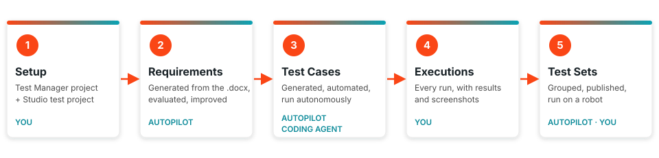

UiPath Partner Success · Workshop
{: .eyebrow }

# 🧪 UiPath Agentic Testing with Coding Agents

**Plan, automate, execute, and report on UiPath tests with Autopilot for Testers, Autopilot for Developers, and a coding agent, from a test case design document to an executed test in Test Cloud.**

!!! tip "Training Environment"
    Log in at **[{{ training_url }}]({{ training_url }})** using tenant **{{ training_tenant }}**.

{ .lifecycle }

## 🎯 What you'll build

This workshop shows you how AI agents work across **UiPath Test Cloud** for you, and where a tester still makes the call.

- 🤖 **Autopilot** works inside the product. In **Studio** it creates requirements, test cases, and test sets. In **Test Manager** it evaluates requirements, generates test cases, and runs a test case autonomously.
- 💻 A **coding agent** like **Codex** or **Claude Code** works from your terminal. With the **`uip` CLI** and the **UiPath skills**, it automates test cases in your Studio project and runs test sets.
- 🏦 You start from a real design document for the **UiBank** demo app.

## 🗺️ The session

The session runs from 9:00 to 17:00, about 8 hours, with two breaks and lunch. After the two parts below, it ends with SAP Testing, Q&A, and feedback. The hands-on part starts with [Setup](setup.md), together in the room.

-   :material-lightbulb-on-outline:{ .lg .middle } **1. Intro + Theoretical Aspects**

    ---

    Test Cloud, Test Manager, Autopilot for Testers, Autopilot for Developers, and coding agents: what each one does, and when to use which.

    [:octicons-arrow-right-24: Agentic Testing & Coding Agents](what-is-a-coding-agent.md)

-   :material-hand-back-right-outline:{ .lg .middle } **2. Hands-on**

    ---

    Five parts, each in its own tab, from an empty project to an executed test set. The Agenda shows how the session runs, step by step.

    [:octicons-arrow-right-24: Agenda](agenda.md)

### The hands-on parts

-   :material-rocket-launch-outline:{ .lg .middle } **Setup**

    ---

    The first hands-on step: your VM, your sign-in, the `uip` CLI, Studio, and your UiBank test user.

    [:octicons-arrow-right-24: Setup](setup.md)

-   :material-cog-outline:{ .lg .middle } **Testing Setup**

    ---

    The scenario, the design document, and the in-session setup: your Test Manager project, and a new test automation project in Studio connected to it.

    [:octicons-arrow-right-24: Testing Setup](agentic-testing-hands-on.md)

-   :material-clipboard-text-outline:{ .lg .middle } **Requirements**

    ---

    Autopilot in Studio creates them from the design document, and Autopilot in Test Manager evaluates them.

    [:octicons-arrow-right-24: Requirements](requirements.md)

-   :material-test-tube:{ .lg .middle } **Test Cases**

    ---

    Autopilot in Test Manager generates them. You automate the Login test case by hand, then Autopilot in Studio or a coding agent automates the next ones, and Autopilot runs one autonomously.

    [:octicons-arrow-right-24: Test Cases](test-cases.md)

-   :material-play-circle-outline:{ .lg .middle } **Executions**

    ---

    Every run, manual, automated, or autonomous, with its results and screenshots.

    [:octicons-arrow-right-24: Executions](executions.md)

-   :material-package-variant-closed:{ .lg .middle } **Test Sets**

    ---

    Autopilot groups your test cases, you run them, and you read the results.

    [:octicons-arrow-right-24: Test Sets](test-sets.md)

Each part comes with the prompts you'll use.

## 🔑 Key concepts

💻
Coding agent

An AI assistant (e.g., Claude Code) that builds and runs UiPath components from your instructions, using the `uip` CLI and UiPath skills.

⌨️
`uip` CLI

The command-line interface coding agents use to talk to the UiPath platform, including Test Manager (`uip tm`) and Studio projects (`uip rpa`).

🧩
UiPath skills

Curated instruction packs that teach a coding agent how to work with UiPath correctly. This workshop uses `uipath-test`, `uipath-rpa`, and `uipath-platform`.

📋
Test Manager

The Test Cloud hub for requirements, test cases, test sets, executions, and results.

🤖
Autopilot for Testers

UiPath's built-in testing agents in Studio and Test Manager. They generate and evaluate requirements, generate test cases and test sets, run test cases autonomously, and explain test results.

🪄
Autopilot for Developers

Autopilot in Studio for building and fixing automations: it generates and fixes expressions from the workflow's context.

