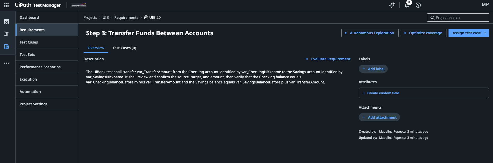

动手实践 · 第 1 部分，共 4 部分
{: .eyebrow }

# 📋 需求 { #requirements }

<div style="font-size: 15px; font-style: italic; color: #d1603a; margin: -0.6rem 0 1rem;">从设计文档到你愿意签字确认的需求</div>

<div style="background: #faf8f6; border: 1px solid #eee3dc; border-left: 4px solid #FA4616; padding: 18px 22px; margin: 1.4rem 0;">
  <div style="font-size: 14px; font-weight: 700; letter-spacing: 0.09em; color: #FA4616; margin-bottom: 9px;">你需要准备</div>
  <ul style="margin: 0; padding-left: 18px; font-size: 15px; color: #4a4a4a; line-height: 1.55;"><li style="margin-bottom: 5px;">在 <strong>Studio</strong> 中打开你的 <code>{YourName}UiBankTests</code> 项目，并已连接到你的 <strong>{YourName}_UIB_Test</strong> Test Manager 项目。参见<a href="../agentic-testing-hands-on/#setup">环境准备</a>。</li><li style="margin-bottom: 5px;">在浏览器中打开同一租户上的 <strong>Test Manager</strong>。</li></ul>
</div>

## 🪄 让 Autopilot in Studio 创建需求 { #ask-autopilot-in-studio-to-create-the-requirements }

输入设计文档，输出需求，没人需要手动输入。后面的每个部分都基于这些需求，所以如果一种方式失败，就换下一种。

=== "Autopilot in Studio"

    1. 在 Studio 中打开 **Autopilot** 面板。
    2. 把 `E2E UiBank Online Banking.docx` 附加到对话中，然后给 Autopilot 这个提示词：

        ```text
        Generate the requirements for the UiBank web application from the
        attached design document. Create one requirement per step in section 3,
        Step 0 to Step 7, in that order.
        ```

    3. 检查 Autopilot 提出的内容，然后接受这些需求，让它们保存到你的 Test Manager 项目中。

    从文档创建需求目前还不在 Studio 中已记录的 Autopilot 测试工具之列。如果 Autopilot 无法保存它们，请使用你的编码智能体。

=== "使用你的编码智能体"

    在你的 workshop 文件夹中启动编码智能体，并给它这个提示词：

    ```text
    Read ./E2E UiBank Online Banking.docx and create one requirement per step
    in section 3, Step 0 to Step 7, in order, in my {YourName}_UIB_Test
    Test Manager project, with the step's acceptance criteria in the
    description. Confirm `uip login status` first.
    ```

    编码智能体会加载 `uipath-test` 技能。由于没有导入命令，它会为每个步骤运行一次 `uip tm requirements create`，共八次。

=== "手动创建"

    在 Test Manager 中打开 **Requirements**，为每个步骤选择 **Create**。用步骤标题为每个需求命名，并把该步骤的验证内容复制到描述中。这样更慢，但能让当天剩下的内容继续进行。

!!! warning "Autopilot 不见了，或者无法保存需求？"
    通常有两个原因。一是 Studio 登录到了错误的环境：本课程中的 Autopilot 功能在 **{{ env_label }}** 上，所以请让 Studio 登录到 **{{ training_authority }}**、组织 **{{ training_org }}**、租户 **{{ training_tenant }}**。二是项目没有连接到你的 Test Manager 项目：检查 Studio 中的 Test Manager 设置，或者让你的编码智能体在项目文件夹中运行 `uip rpa tm status`。

## 💬 在 Test Manager 中讨论需求 { #discuss-the-requirements-in-test-manager }

在 Test Manager 中刷新 **Requirements**。你应该能看到八个需求，每个对应设计文档的一个步骤，键为 `{YourPrefix}:1` 到 `{YourPrefix}:8`。Autopilot 生成的名称和措辞可能与下面不同：

<div class="circles" markdown>

<div class="circle-item" markdown>
<span class="num">0</span>
<div class="ci-body" markdown>

**Login and Initial Account State**

`{YourPrefix}:1` · Step 0

</div>
</div>

<div class="circle-item" markdown>
<span class="num">1</span>
<div class="ci-body" markdown>

**Checking Account Creation**

`{YourPrefix}:2` · Step 1

</div>
</div>

<div class="circle-item" markdown>
<span class="num">2</span>
<div class="ci-body" markdown>

**Savings Account Creation**

`{YourPrefix}:3` · Step 2

</div>
</div>

<div class="circle-item" markdown>
<span class="num">3</span>
<div class="ci-body" markdown>

**Funds Transfer Between Accounts**

`{YourPrefix}:4` · Step 3

</div>
</div>

<div class="circle-item" markdown>
<span class="num">4</span>
<div class="ci-body" markdown>

**Loan Application Submission**

`{YourPrefix}:5` · Step 4

</div>
</div>

<div class="circle-item" markdown>
<span class="num">5</span>
<div class="ci-body" markdown>

**Loan Status Lookup**

`{YourPrefix}:6` · Step 5

</div>
</div>

<div class="circle-item" markdown>
<span class="num">6</span>
<div class="ci-body" markdown>

**User Profile Identity Verification**

`{YourPrefix}:7` · Step 6

</div>
</div>

<div class="circle-item" markdown>
<span class="num">7</span>
<div class="ci-body" markdown>

**Logout and Evidence Collection**

`{YourPrefix}:8` · Step 7

</div>
</div>

</div>

打开其中两三个，并以小组形式讨论：

- **可追溯性。** 从每个需求能否看出它来自文档的哪个步骤？
- **可测试性。** 你能为每条验收标准写出通过/失败检查吗？哪些比较含糊？
- **缺口。** 文档没有说明转账金额大于余额时会怎样，也没有说明贷款审批规则。Autopilot 注意到了吗，还是跳过了？它有没有编造文档中没有的内容？

!!! tip "为什么每个步骤一个需求"
    八个小需求比一个大需求更容易评估、覆盖和报告。之后某个测试失败时，你能准确知道它影响的是哪个步骤、哪个需求。

## 🔍 使用 Autopilot in Test Manager 评估、改进并重新评估 { #evaluate-improve-and-re-evaluate-with-autopilot-in-test-manager }

Test Manager 的 **Evaluation Agent** 会检查需求的清晰度、完整性和可测试性。

1. 在 **Requirements** 下打开 **Funds Transfer Between Accounts**。
2. 选择 **Description** 旁边的 **Evaluate Requirement**。阅读 Autopilot 的发现和建议。

    { .screenshot width="900" }
    *转账需求，Description 旁边是 Evaluate Requirement。*

3. 选择两三条你认同的建议，通过编辑需求来落实。典型的一条是：转账金额大于源账户余额时的规则。如果文档没有回答某个问题，就把它写成待解决问题，而不是自己编一个答案。
4. 再次评估该需求。结果改善了吗？Autopilot 有没有提出新的问题？
5. 对 **Loan Application Submission** 重复上述操作，它是未记录规则最多的需求。

!!! tip "添加你自己的提示词"
    Autopilot 使用项目 **Prompt Library** 中的提示词来评估需求。除了预定义的提示词（例如 **Multifaceted Audit**、**Performance Evaluation** 和 **Security Assessment**），你还可以为团队自己的质量规则添加自定义提示词：

    1. 在 Test Manager 中，在项目左侧菜单选择 **Project Settings**，然后选择 **Prompt library** 选项卡。
    2. 选择 **Add prompt**。
    3. 在 **Create prompt** 中填写：
        - **Name** 和 **Description**，让其他人知道何时使用它。
        - **Mode of use**：评估类提示词选择 **Evaluate requirement quality**。其他模式包括 **Create tests from requirement**、**Import test cases** 和 **Autonomous Exploration**。
        - **Prompt**：给 Autopilot 的指令，尽可能具体、详细。
    4. 选择 **Create**。

    之后，当你评估或重新评估需求时，你的提示词会出现在预定义提示词旁边。

    <video src="../../requirements.images/test-manager-add-custom-prompt.mp4" autoplay loop muted playsinline controls aria-label="在 Test Manager 中添加自定义提示词：Project Settings、Prompt library、Add prompt，填写 Name、Description、Mode of use 和 Prompt，然后选择 Create" style="display: block; width: 100%; margin: 1.5rem auto; border: 1px solid var(--md-default-fg-color--lightest); border-radius: 4px; box-shadow: 0 2px 8px rgba(0, 0, 0, 0.12);"></video>

!!! success "需求完成"
    Autopilot 根据设计文档生成了八个需求，你们讨论过它们，并对其中至少两个进行了评估、改进和重新评估。

!!! info "Autopilot 起草，你来决定"
    Evaluation Agent 擅长发现含糊的措辞和遗漏的情况，但它无法知道你的业务规则。你接受的每一条建议都是关于 UiBank 必须做什么的决定，所以应该得到产品负责人的认可。
