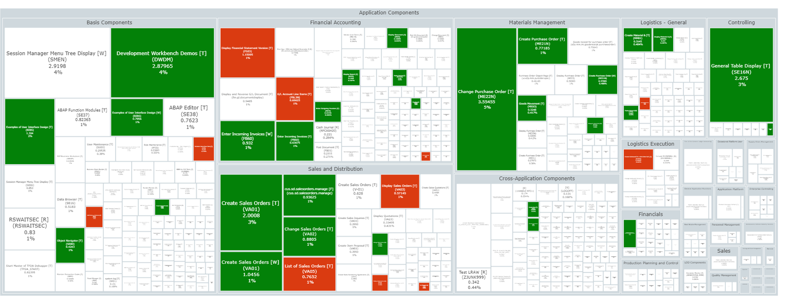
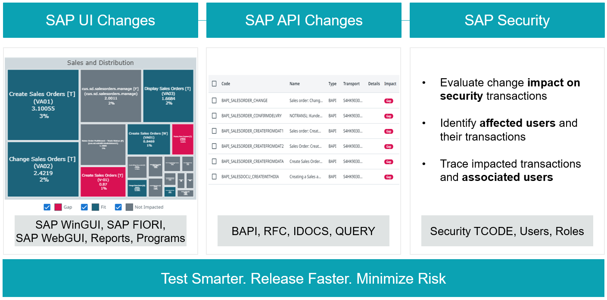
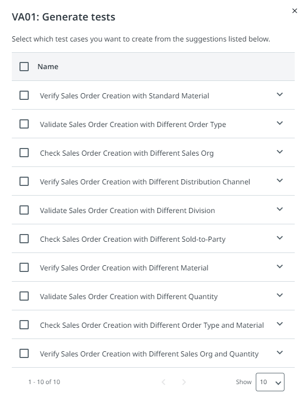
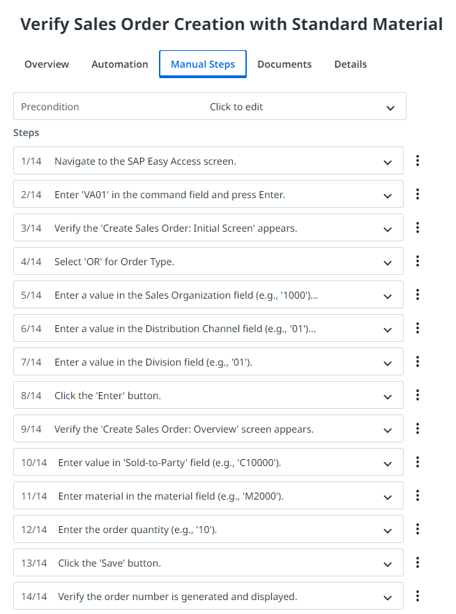
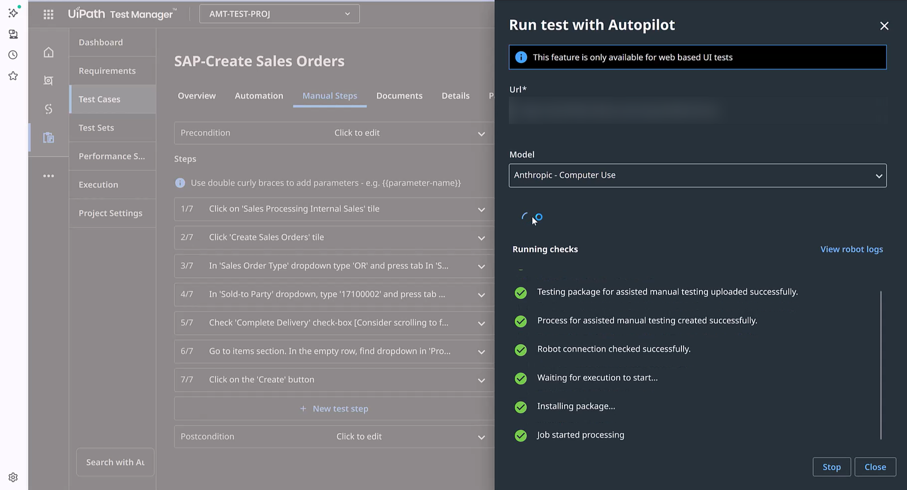
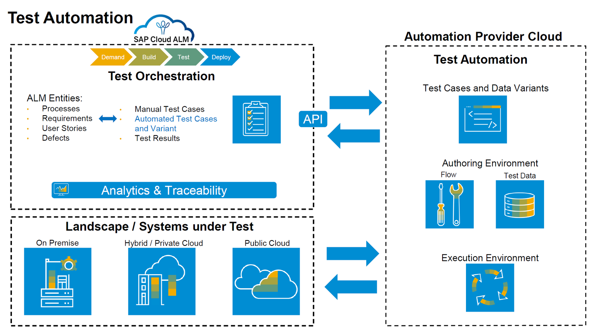
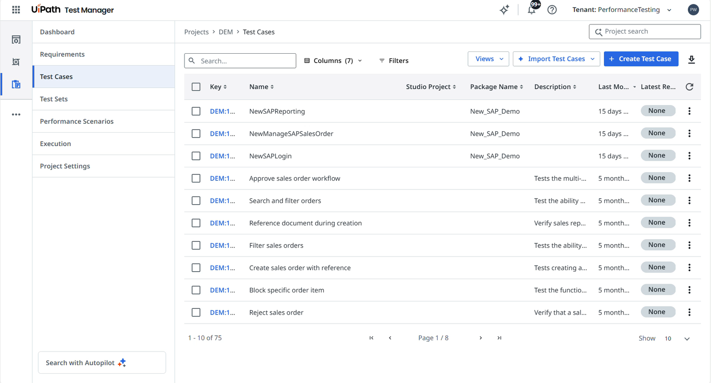

Presentation + demo
{: .eyebrow }

# 🧩 SAP Testing

The same Test Cloud, applied to SAP

All day you've tested a small web app, UiBank. Now you'll see how the same **Test Cloud** — **Test Manager**, **Autopilot for Testers**, robots, and coding agents — tests SAP, one of the most business-critical systems a company runs. You don't need SAP experience: the key terms are below.

## 📖 SAP in two minutes

**SAP** makes ERP software: the system a company uses to run finance, sales, purchasing, HR, and manufacturing, all on shared data.

| Term | What it means |
|---|---|
| **SAP ECC / SAP S/4HANA** | The previous and the current generation of SAP's ERP. Many companies are migrating from ECC to S/4HANA. |
| **RISE with SAP** | SAP's offer for moving to SAP S/4HANA in the cloud. |
| **SAP GUI / SAP Fiori** | The classic Windows desktop client, and the modern web-based UI. |
| **Transaction** | A function you open in SAP by its code, for example VA01 to create a sales order. |
| **Transport** | A package of SAP changes moved from development to test to production. Each transport is a reason to retest. |
| **Order-to-Cash / Procure-to-Pay** | End-to-end business processes, from a customer's order to the payment, and from a purchase request to paying the supplier. |
| **Clean Core** | SAP's principle of keeping the standard system unmodified, with custom logic in extensions and APIs outside it. |
| **SAP Cloud ALM** | SAP's tool for managing implementation projects, including requirements and tests. |

## 🤔 Why SAP testing is hard: the coverage illusion

SAP teams have long reported **coverage**: the percentage of transactions or test cases they ran. But coverage measures what's easy to count, not what's likely to break. Today, what breaks is often not inside SAP, but at the seams between SAP and everything around it.

🧼
Clean Core

Custom logic moves out of the ERP, into extensions, SAP BTP services, and APIs.

☁️
SaaS around SAP

Salesforce, ServiceNow, and Workday now run parts of the business that used to live in SAP.

⏩
Faster releases

SAP ships quarterly, other vendors weekly. Far more change flows through the company than ten years ago.

The typical late-release failures: integration handoffs that pass one by one but time out together, SAP Fiori screens that drift after a quarterly release, and authorization changes that quietly produce wrong results. A "100% SAP coverage" report catches none of them.

## 💼 Where customers use Test Cloud for SAP

🔁
Regression testing

Keep pace with SAP's quarterly updates, and run only the tests each change affects.

🚚
S/4HANA migration

Test every phase, from data preparation to cutover, and reuse the tests across migration waves.

🖥️
SAP GUI and SAP Fiori

Automate every SAP interface, with self-healing when the screens change.

🔗
Cross-system processes

Test end-to-end processes across SAP, Salesforce, Oracle, Workday, and custom apps.

**What customers get:** 529% ROI over 3 years with a six-month payback, 62% faster test execution, 52% less manual effort, and 55% higher test coverage. **EDF Renewables** automated 90% of its SAP testing in five months.

## 🚀 What Test Cloud does for SAP

### 🎯 Decide what to test

🔥
SAP Heatmap

Connects to the production SAP system and shows which transactions people actually use, so you test the business-critical ones first.

🎯
Change Impact Analysis

When a transport is staged, AI finds the processes it affects and gives you a risk-ranked list of tests to rerun, instead of rerunning everything.

🕳️
Test Gap Analysis

Finds the critical SAP processes that have no tests yet.

{ .screenshot .full }
*The usage heatmap: the bigger the tile, the more an SAP component or transaction is used.*

{ .screenshot .full }
*Change Impact Analysis covers UI changes, API changes, and security changes.*

### 🤖 Create and automate the tests

📝
Generate test cases

Autopilot creates test cases for SAP transactions from the requirements or the Heatmap data, like it did for UiBank.

🧮
Generate test data

SAP Test Data Agents create realistic data on demand, such as customers, materials, and sales orders.

🛠️
Automate low-code or coded

Business users and developers both build the automations, in Studio or with a coding agent, like you did today.

🩹
Self-healing

When an SAP screen changes, the automation repairs the selector in real time instead of failing.

{ .screenshot }

{ .screenshot }

*Test cases generated for VA01, creating a sales order: the suggestions (left), and the manual steps of one of them (right).*
{: .img-pair-caption }

### ▶️ Run them right away

**Autonomous Test Execution** runs a manual SAP test from its natural-language steps — the same **Run Autonomously** you used in [Test Cases](test-cases.md). You can test from the first day of the project, before any automation exists.

{ .screenshot width="900" }
*Run Autonomously on an SAP Fiori test case.*

### 🔗 Fit into SAP delivery

Test Cloud connects to **SAP Cloud ALM**: Cloud ALM manages the requirements, and Test Cloud automates and runs the tests across SAP and non-SAP systems, with every result linked back to its requirement. It also connects to CI/CD tools. With **Maestro**, one pipeline can test the whole process — the SAP transport, a Fiori approval, a Salesforce sync, and the invoice — and return one verdict.

{ .screenshot width="900" }
*SAP Cloud ALM orchestrates the tests; UiPath automates and runs them, and sends the results back. Confirm the integration options for each project during solution design.*

### 📈 Test under load

Performance testing is built into Test Cloud. You reuse the UI and API automations you already have, so one set of automations covers functional and performance tests.

🧰 Dedicated load testing tools

- A separate script set, written by a performance engineer
- Synthetic HTTP traffic at the protocol level

VS

📈 Performance testing in Test Cloud

- Reuses your functional automations, with Autopilot planning the scenarios
- The real user experience through the UI, including rendering

You can run load, spike, stress, and endurance tests, in the cloud or on-premises, triggered from your CI/CD pipeline. The results appear in Test Manager, next to the functional ones.

{ .screenshot width="900" }
*Performance Scenarios in Test Manager, next to the Test Cases you know.*

## 🎬 Demo

!!! note "Demo coming soon"
    The demo for this part will be added here soon.

## 📏 Measure processes, not test cases

Today you reported results per test case. In an SAP landscape, the business asks a different question: does **order-to-cash** work, from start to finish, across every system it touches?

🧭
Report by business process

"412 of 430 tests passed" becomes "Order-to-cash: two failures in the Salesforce handoff, both from the quarterly release."

🔺
End-to-end tests get cheap

Generated tests, self-healing, and orchestrated runs make them the baseline of every regression. Human time goes to exploring what agents won't predict.

🛡️
QA governs, agents execute

Agents generate, run, and analyse the tests. Testers decide which processes must stay green and which risks are acceptable.

## 🔄 How it maps to what you did today

1

**Decide what to test:** Heatmap and Change Impact Analysis. *Today: the requirements from the design document.*

2

**Create test cases and data:** Autopilot and Test Data Agents. *Today: Autopilot generated the test cases.*

3

**Run them right away:** Autonomous Test Execution. *Today: Run Autonomously.*

4

**Automate and run on robots.** *Today: Autopilot or a coding agent automated the test cases, and the test sets ran them.*

5

**Keep it running and explain the results:** self-healing and test insights. *Today: Generate Insights on the test set results.*

## 📚 Learn more

<a class="link-card" href="https://www.uipath.com/platform/agentic-testing/sap-testing" target="_blank" rel="noopener">🧩SAP testing with Test CloudUse cases, benefits, and FAQs</a>
<a class="link-card" href="https://www.uipath.com/platform/agentic-testing/performance-testing" target="_blank" rel="noopener">📈Performance testingLoad, spike, stress, and endurance tests from your existing automations</a>

!!! tip "Training Environment"
    Log in at **[{{ training_url }}]({{ training_url }})** using tenant **{{ training_tenant }}**.
