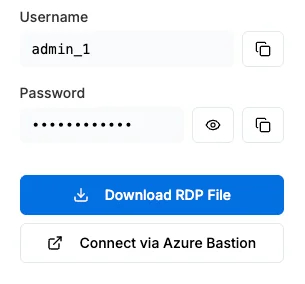
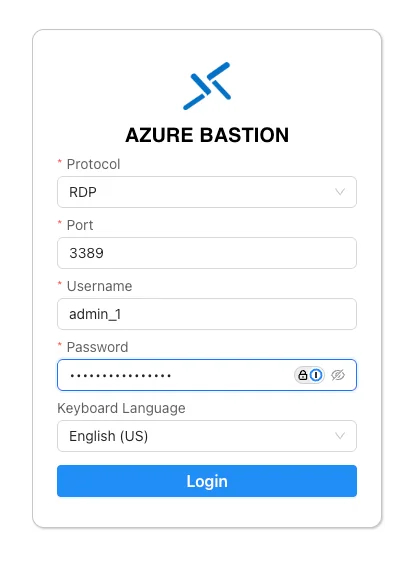
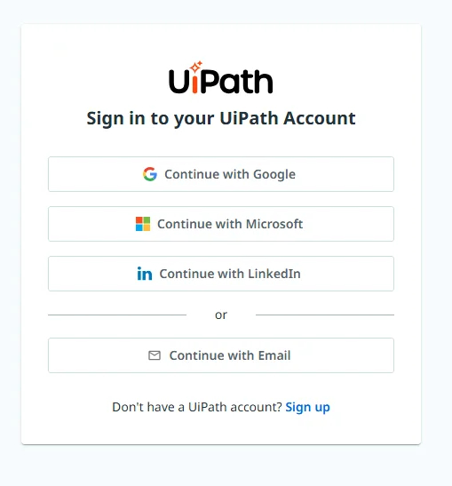
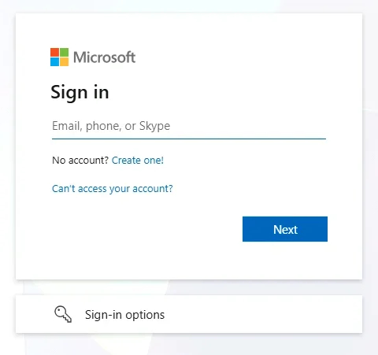
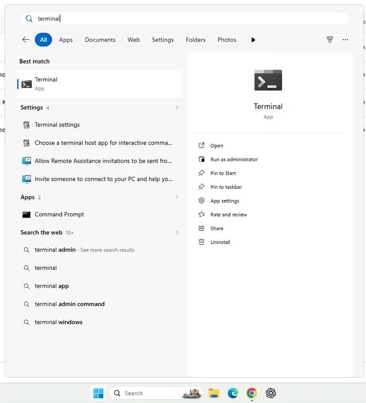

Hands-on · First step
{: .eyebrow }

# 🧰 Setup

**The first thing you do in the hands-on part: your VM, your sign-in, your tenant, and your test data. Work through it top to bottom — each section verifies itself before you move on.**

!!! info "We do this together"
    Setup is part of the session: the trainer walks the room through it at the start of the hands-on part, right after the intro. If a step fails, raise your hand before you move on.

!!! tip "Training Environment"
    Log in at **[{{ training_url }}]({{ training_url }})** using tenant **{{ training_tenant }}**.

## 🖥️ 1. Connect to Your VM

Each participant gets a virtual machine (VM) with the tools already installed. You'll do the rest of this page, and the whole session, inside it.

1. Open the VM details you received. They show the VM's **Username** and **Password**, with copy buttons.
2. Select **Connect via Azure Bastion**. It opens the VM in a browser tab, so you don't need an RDP client.

    { .screenshot width="320" }

3. In the **Azure Bastion** form, keep **Protocol** on **RDP** and **Port** on **3389**. Enter the VM's username and password, pick your **Keyboard Language**, and select **Login**.

    { .screenshot width="420" }

4. When your browser asks whether to allow clipboard access, accept it. You'll paste prompts into the VM all day.
5. Wait for the VM's Windows desktop to load in the browser tab.

!!! tip "Can't paste into the VM with Ctrl+V?"
    In the Chrome browser on your own machine, open `chrome://settings/content/clipboard` and make sure the Bastion site isn't under **Not allowed to see your clipboard**.

## 🔑 2. Sign In to the Training Environment

From here on, work **inside the VM**.

1. Open **Google Chrome** in the VM and go to **[{{ training_url }}]({{ training_url }})**.
2. Select **Continue with Microsoft**.

    { .screenshot width="420" }

3. Sign in with the username and password from the **Your Workshop Account** area of your workshop details, not with your own account. Enter the username, select **Next**, then enter the password and select **Sign in**.

    { .screenshot width="420" }

## ✅ 3. Confirm the Tenant

Once you're in, open **Studio Web**. In the upper-right corner, check that the tenant picker shows **{{ training_tenant }}**. If it shows another tenant, switch to **{{ training_tenant }}** before you go on.

## 💻 4. Open the Terminal

1. In the VM, open the Windows search and type `terminal`.
2. Select the **Terminal** app.

    { .screenshot width="500" }

The VM already has your coding agent, the `uip` CLI, and the UiPath skills installed, so there's nothing else to install. You'll use this terminal in the next sections.

## 🔐 5. Authenticate with Your Tenant

The workshop runs on **{{ env_label }}**, where the newest Autopilot for Testers and Autopilot for Developers features are available. Point the CLI there:

```bash
uip login --authority {{ training_authority }} --organization {{ training_org }} -t {{ training_tenant }}
```

Verify you're pointed at the right place:

```bash
uip login status --output json
```

Then open **Test Manager** once in the browser at **[{{ training_url }}]({{ training_url }})** and check you can see the **Projects** page. If you can't, ask the trainer to give you access.

Check that a robot can run your tests in the `{{ training_folder }}` folder. Ask your coding agent to run:

```bash
uip or folders runtimes {{ training_folder }}
```

It must show a runtime that's **Available**. Later, a test job must not stay Pending with the reason `RobotNoCredentials`. If either check fails, tell the trainer.

!!! info "Trainer checklist: the tenant side"
    The trainer sets these up before the session. Participants can't fix them themselves:

    - An **App Test Developer** licence for every participant.
    - An **AI Trust Layer** policy that allows Autopilot.
    - The **{{ training_folder }}** folder, with rights to create assets and to run test sets.
    - A robot in that folder with a **Testing** or **Production** runtime, and a **robot account with stored credentials** assigned to the folder. Without the credentials, a test set job stays Pending with `RobotNoCredentials`, even when the runtime shows Connected and Available.
    - A **Windows** robot in the folder for **Run autonomously**: autonomous runs are supported on Windows only.

## 🔗 6. Connect Studio to the Training Tenant

Autopilot in Studio works against the tenant Studio is signed in to. Sign Studio in to the same place as the CLI:

1. Open **Studio**. If you're signed in to another environment, such as `cloud.uipath.com`, sign out.
2. Before signing in again, change the cloud URL to `{{ training_authority }}`. In **UiPath Assistant**, it's under **Preferences** > **Orchestrator Settings**, as the **Service URL**.
3. Sign in, then select the organization **{{ training_org }}** and the tenant **{{ training_tenant }}**.
4. Check that the **Autopilot** panel is available in Studio. If it isn't, ask the trainer before you go on — the hands-on part starts with it.

!!! warning "One environment for everything"
    Studio, the `uip` CLI, and your browser must all point at **{{ training_url }}**. If one of them is still on another environment, Autopilot saves requirements to a project your coding agent can't see.

## 🏦 7. Register Your UiBank Test User

The test cases log in as a registered UiBank user. Create yours now, so they have an account to run against.

1. Go to **[uibank.uipath.com/register-account](https://uibank.uipath.com/register-account)**.
2. Fill in the form: first, middle, and last name, sex, email, username, and a password. Use a password you don't use anywhere else — UiBank is a public demo site.
3. Register, then log in at **[uibank.uipath.com/login](https://uibank.uipath.com/login)** to check the account works.

4. If UiBank shows an **Important Notice** dialog after you sign in, select **I agree to the Privacy Policy**. Closing it with ✕ leaves you logged out. Accept it now, by hand, before you automate anything.

The tests never store your password in the project. They read it from an Orchestrator **credential asset**. Create it by hand:

1. In **Orchestrator**, open the `{{ training_folder }}` folder and go to **Assets**.
2. Select **Add** > **Credential**, and name it `{YourName}_UiBankCredential`.
3. Type your UiBank username and password there, then save.

!!! warning "Don't give the password to your coding agent"
    The `uip` CLI takes a credential only as `username:password` on the command line, so a coding agent asks for it in the chat. The password then ends up in the transcript and in a command. Type it in Orchestrator instead.

!!! warning "Write down your UiBank email"
    You'll need it as `var_LoanEmail` in the hands-on session — the profile check in Step 6 compares it with the email UiBank shows.

## 📄 8. Download the Design Document

Create a folder named `workshop`, and download the [design document](resources.md#the-design-document) into it. It should look like this:

```text
workshop/
└── E2E UiBank Online Banking.docx   ← the design document
```

You'll create your Test Manager project and your Studio project at the start of the session.

!!! success "You're set up"
    Your VM, signed in to {{ training_tenant }} in the browser, in Studio, and in the `uip` CLI, with a UiBank test user and the design document. Time to test something.
