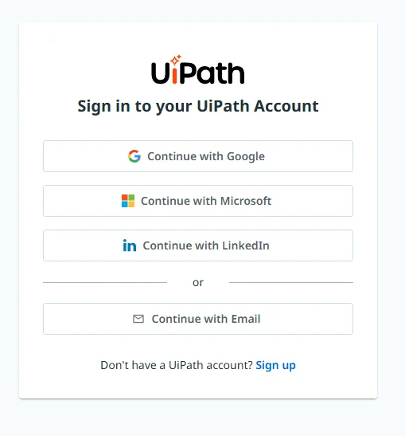
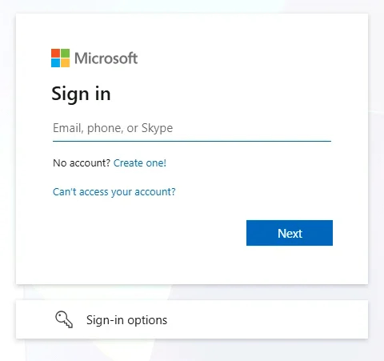

Hands-on · First step
{: .eyebrow }

# 🧰 Setup

**The first thing you do in the hands-on part: your VM, your sign-in, your tenant, and your test data. Work through it top to bottom — each section verifies itself before you move on.**

!!! info "We do this together"
    Setup is part of the session: the trainer walks the room through it at the start of the hands-on part, right after the intro. If a step fails, raise your hand before you move on.

!!! tip "Training Environment"
    Log in at **[{{ training_url }}]({{ training_url }})** using tenant **{{ training_tenant }}**.

## 🔑 1. Sign In to the Training Environment

From here on, work **inside the VM**.

1. Open **Google Chrome** in the VM and go to **[{{ training_url }}]({{ training_url }})**.
2. Select **Continue with Microsoft**.

    { .screenshot width="420" }

3. Sign in with the username and password from the **Your Workshop Account** area of your workshop details, not with your own account. Enter the username, select **Next**, then enter the password and select **Sign in**.

    { .screenshot width="420" }

## ✅ 2. Confirm the Tenant

Once you're in, open **Studio Web**. In the upper-right corner, check that the tenant picker shows **{{ training_tenant }}**. If it shows another tenant, switch to **{{ training_tenant }}** before you go on.

!!! info "Trainer checklist: the tenant side"
    The trainer sets these up before the session. Participants can't fix them themselves:

    - An **App Test Developer** license for every participant.
    - An **AI Trust Layer** policy that allows Autopilot.
    - The **{{ training_folder }}** folder, with rights to create assets and to run test sets.
    - A robot in that folder with a **Testing** or **Production** runtime, and a **robot account with stored credentials** assigned to the folder. Without the credentials, a test set job stays Pending with `RobotNoCredentials`, even when the runtime shows Connected and Available.
    - A **Windows** robot in the folder for **Run autonomously**: autonomous runs are supported on Windows only.

## 🔗 3. Connect Studio to the Training Tenant

Autopilot in Studio Desktop works against the tenant Studio is signed in to. Sign Studio in to the training tenant:

1. Open **Studio**. If you're signed in to another environment, such as `cloud.uipath.com`, sign out.
2. Before signing in again, change the cloud URL to `{{ training_authority }}`. In **UiPath Assistant**, it's under **Preferences** > **Orchestrator Settings**, as the **Service URL**.
3. Sign in, then select the organization **{{ training_org }}** and the tenant **{{ training_tenant }}**.
4. Check that the **Autopilot** panel is available in Studio. If it isn't, ask the trainer before you go on — the hands-on part starts with it.

!!! warning "One environment for everything"
    Studio, the `uip` CLI, and your browser must all point at **{{ training_url }}**. If one of them is still on another environment, Autopilot saves requirements to a project your coding agent can't see.

## 🏦 4. Register Your ParaBank Test User

The test cases log in as a registered ParaBank user. Create yours now, so they have an account to run against.

1. Go to **[parabank.parasoft.com/parabank/register.htm](https://parabank.parasoft.com/parabank/register.htm)**.
2. Fill in the form: **First Name**, **Last Name**, **Address**, **City**, **State**, **Zip Code**, **Phone #**, **SSN**, **Username**, **Password**, and **Confirm**. Use made-up values for the address, phone, and SSN, and a password you don't use anywhere else — ParaBank is a public demo site.
3. Select **Register**. ParaBank signs you in and gives you a default checking account with a starting balance. The test cases use it to fund the new accounts.
4. Select **Log Out**, then log in again in the **Customer Login** panel at **[parabank.parasoft.com/parabank/index.htm](https://parabank.parasoft.com/parabank/index.htm)**, to check the account works. You land on **Accounts Overview**.

!!! tip "If your login stops working"
    ParaBank's demo database is shared and reset from time to time. If login fails with *"The username and password could not be verified."*, register again with the same username and password. Your credential asset then keeps working.

The tests never store your password in the project. They read it from an Orchestrator **credential asset**. Create it by hand:

1. In **Orchestrator**, open the `{{ training_folder }}` folder and go to **Assets**.
2. Select **Add** > **Credential**, and name it `{YourName}_ParaBankCredential`.
3. Type your ParaBank username and password there, then save.

!!! warning "Don't give the password to your coding agent"
    The `uip` CLI takes a credential only as `username:password` on the command line, so a coding agent asks for it in the chat. The password then ends up in the transcript and in a command. Type it in Orchestrator instead.

!!! warning "Write down your first and last name"
    The login test checks the *"Welcome <First Name> <Last Name>"* text, and the contact info test checks the pre-filled names, so you'll need them in the hands-on session.

## 📄 5. Download the Design Document

Create a folder named `workshop`, and download the [design document](resources.md#the-design-document) into it. It should look like this:

```text
workshop/
└── E2E ParaBank Online Banking.docx   ← the design document
```

You'll create your Test Manager project and your Studio project at the start of the session.

!!! success "You're set up"
    Your VM, signed in to {{ training_tenant }} in the browser and in Studio, with a ParaBank test user and the design document. Time to test something.
